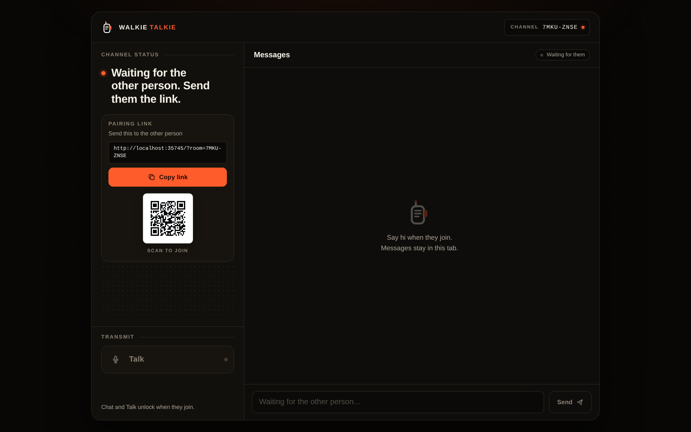
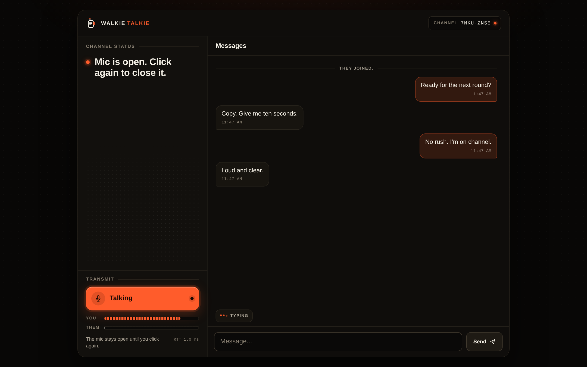
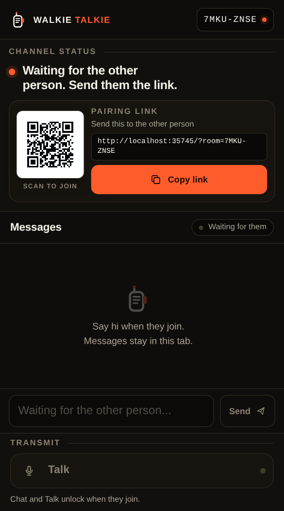
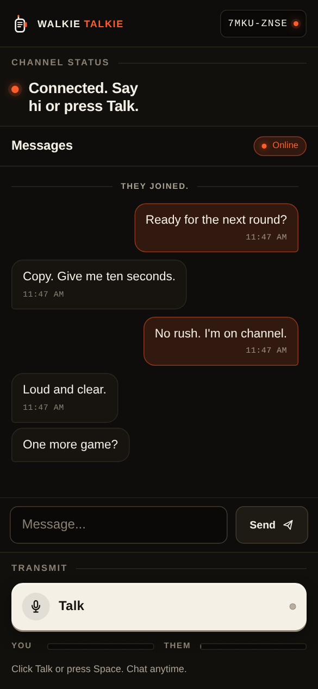

# Walkie Talkie

A low-latency voice channel for a parent and kid to talk while playing games together.

## What it does

- Two people per room. One shares a link or QR code, the other opens it.
- Opening the page asks for the microphone and joins the room automatically.
- Click to talk with Space or the Talk key. Click again to close the mic.
- Send messages back and forth over the same room while you are connected, with a live typing indicator.
- Audio goes peer-to-peer over WebRTC. The server only handles signaling, chat and typing relay, and static files.
- No accounts. The room link is the only key.

## Screenshots

Sample room with sample messages, captured from the app with a fake microphone.

| Waiting for the other person | Live, with the mic open |
| --- | --- |
|  |  |

<table>
  <tr>
    <td align="center"></td>
    <td align="center"></td>
  </tr>
  <tr>
    <td align="center"><sub>Waiting on a phone</sub></td>
    <td align="center"><sub>Live on a phone</sub></td>
  </tr>
</table>

## Quick start

Requires Node 22 or newer.

```sh
npm install
npm start
```

Open <http://localhost:8787>, allow the microphone, then send the link to the other person (or show them the QR code). They open it and allow the microphone too. Once they join, the message box unlocks and the Talk key turns on.

The server listens on all interfaces at port 8787. Set `PORT` or `HOST` to change that.

## Microphone access and HTTPS

Browsers only allow microphone capture in a secure context. `localhost` counts. A LAN address over plain HTTP does not.

Options:

- Run both browser windows on the same machine at `http://localhost:8787`.
- Put the app behind HTTPS with Caddy, nginx, or Tailscale Serve.
- Use the built-in TLS support.

Caddy handles certificates and WebSocket upgrades with a two-line config:

```
talk.example.com {
  reverse_proxy 127.0.0.1:8787
}
```

Built-in TLS:

```sh
TLS_CERT=/path/fullchain.pem TLS_KEY=/path/privkey.pem npm start
```

The certificate must match the hostname people open. The server switches to `wss://` automatically.

## TURN fallback

Direct peer-to-peer fails on some networks, such as symmetric NATs and some mobile carriers. Add a TURN server so the call can still connect:

```sh
TURN_URL=turn:turn.example.com:3478 \
TURN_USER=user \
TURN_PASS=secret \
npm start
```

`STUN_URLS` defaults to `stun:stun.l.google.com:19302` and accepts a comma-separated list. All three TURN variables are needed before TURN is offered to clients.

Static TURN credentials are visible to every browser that loads the app. For a public deployment, use short-lived TURN credentials instead.

## Latency

The design targets mouth-to-ear latency well under 150 ms:

- Opus over WebRTC, mono, capped at 32 kbps.
- Microphone track uses `contentHint = "speech"`.
- Receiver uses `jitterBufferTarget = 0` where the browser supports it.
- Click-to-talk toggles `track.enabled`. It never renegotiates on toggle.
- Media stays peer-to-peer, with no server in the audio path.

Measured with a real acoustic loop on one desktop:

| Metric | Value |
| --- | --- |
| Loop separation, direct click to app echo | 157 to 164 ms |
| Estimated device mouth-to-ear | 155 to 162 ms |
| Network RTT | 0 to 1 ms |
| Inbound jitter buffer delay | 30 to 36 ms |
| Microphone capture latency | 10 ms production, 21 ms raw probe |
| Inbound audio | about 4 KB at about 19 kbps while the other peer's mic was open |

The test plays a 2 kHz click, records the sink monitor, and compares the direct click with the app echo. The separation includes one speaker-to-mic hop of about 2 ms, which is subtracted from the device estimate. Raw probe mode disables echo cancellation, noise suppression, and gain control so the echo stays visible. Production mode adds that processing.

The 150 ms target is not met. The measured device path is about 155 to 162 ms, missing the target by roughly 5 to 12 ms. The server is not in this path, so its language and speed cannot change this number. The remaining time is in the browser audio pipeline. Capture and the 30 to 36 ms jitter buffer are measured. The rest is inferred to be encode, decode, and output buffering, not yet isolated. Replacing the audio element with Web Audio output did not show a clear win in a limited experiment.

## Tests

```sh
npm test
```

Runs 31 server tests. They cover room capacity, invalid codes, join and relay behavior, chat delivery and validation, typing relays, close codes, peer-leave cleanup, static path traversal, health, config, and WebSocket upgrade rules.

```sh
npx playwright install chromium   # once
npm run test:e2e
```

The end-to-end harness starts a real server, launches two Chromium contexts with a fake microphone, pairs them without a start click, proves the QR code renders, proves a 390x700 viewport keeps the QR code and message log visible, proves the typing indicator appears and clears, exchanges chat messages both ways, shrinks the visual viewport to simulate an iPhone keyboard and proves the newest messages and composer stay visible, clicks to talk, asserts that audio bytes arrive, proves the mic latches open and closed, checks the real Space key, reads network RTT, closes the mic when the peer leaves, has both peers leave and rejoin, and saves a screenshot to `test-results/e2e-live.png`.

```sh
npm run screenshots
```

Regenerates the README screenshots in `docs/screenshots/` at desktop and phone sizes with the same fake microphone setup. It does not touch the test proof.

```sh
npm run test:latency
```

Runs the acoustic mouth-to-ear rig. It needs a desktop session, a real microphone and speaker, and `pactl`, `parec`, `paplay`, and `wpctl`. It opens a headed Chromium window, briefly raises the sink volume, plays a click, and restores the volume. It defaults to raw probe mode. `LATENCY_PROBE=0` measures the processed microphone path, where echo cancellation and noise suppression can hide the echo.

## How it works

```
client/
  index.html    page shell, message thread, and the DOM contract
  app.js        UI state, room URLs, WebSocket signaling, chat, typing, click-to-talk
  rtc.js        one audio transceiver, offer/answer, trickle ICE, stats
  audio.js      local and remote level meters
  mark.svg      station mark
  favicon.svg   dark tab icon
  qr.js         QR renderer
  styles.css    console layout, message log, and transmit key
server/
  index.js      HTTP, TLS, static files, WebSocket signaling plus chat and typing relay
  rooms.js      in-memory rooms, two peers, membership cleanup
docs/
  CONTRACT.md   frozen protocol, DOM ids, and debug API
  screenshots/  README captures
test/
  rooms.test.js
  signaling.test.js
  e2e.mjs
  screenshots.mjs
```

The first person opens the page and gets a random code such as `ABCD-EFGH`. The code lives in the URL. The page requests the microphone immediately and joins the room. When the second peer connects, the server marks one side as the offerer. The peers exchange SDP and ICE through the signaling socket, then audio flows directly between browsers.

Text messages and typing state use the same signaling socket. The server trims each message, caps it at 2000 characters, and relays it to the other peer with a timestamp. Typing state is relayed as it changes and is not stored. Nothing is echoed to the sender, and both are dropped if nobody else is in the room.

Rooms are in memory and disappear when the last peer leaves. The server never sees audio, never inspects SDP, and logs no room codes, addresses, message text, or typing state.

## Design

The interface is a two-way console: a channel readout, a status rail, a running message log, and one transmit key. `PRODUCT.md` records the product point of view and the references behind it; `DESIGN.md` holds the color, type, spacing, and component rules. The app uses system fonts, one accent color, and no external assets.

## Limits

- Space works only while the page has focus. A global talk key needs a native wrapper.
- There is no voice activity detection. The mic is open or closed, never speech-gated.
- There is no leave button or microphone-off control. Close the tab to stop capture.
- Chat is relayed in memory and not stored. A peer who joins later sees only messages sent after they arrive, and there are no delivery receipts.
- Because the page joins on load, the browser shows the microphone prompt immediately. Some browsers block remote audio until you interact with the page; a "Tap to hear them" button appears when that happens.
- Chat transits the signaling server, so it is not end-to-end encrypted. Use HTTPS when you are not on localhost.
- The room code is the only access control. Anyone with the code can take the open slot. There is no join rate limiting.
- Rooms live in one process. Running multiple servers would require shared signaling state.
- Two participants only.
- No TURN server is bundled.
- The e2e harness covers Chromium. Firefox and Safari are untested.
- A transient `disconnected` peer connection is not surfaced. Only `failed` triggers recovery.

## Status

Working v1.2 with voice, text, and typing state. The measured mouth-to-ear latency is about 160 ms, over the 150 ms target. The next useful steps are reducing browser audio latency, splitting the remaining pipeline delay into encode, decode, and output buffering, a global talk-key wrapper for Linux, a TURN deployment recipe with short-lived credentials, and an explicit leave control.
